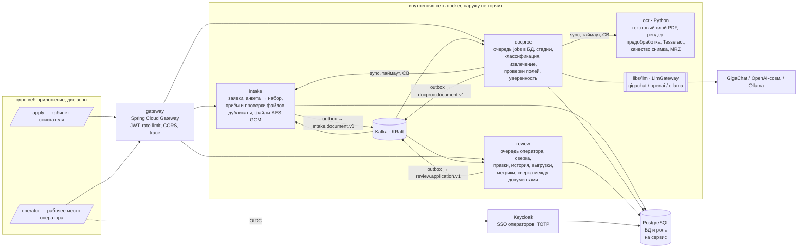
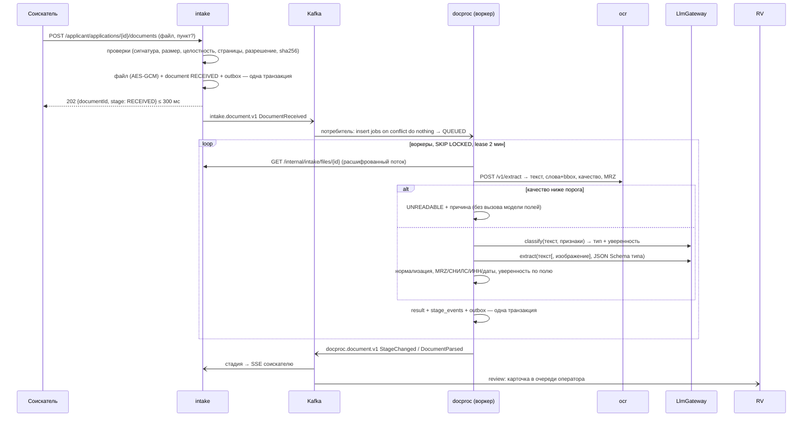
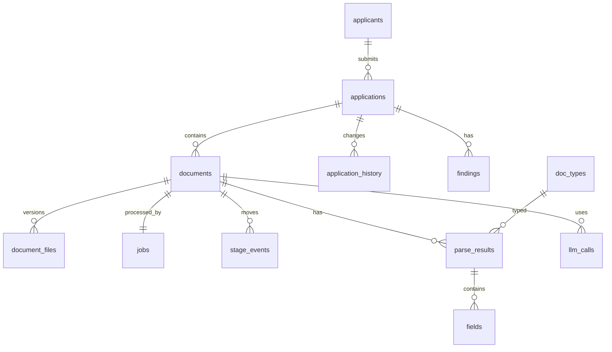

# Архитектура — «Документы»

Повторяет «Проходную» (`../../proxodnaya/docs/ARCHITECTURE.md`): микросервисы на Java/Spring за gateway, Python там, где он сильнее, Kafka + transactional outbox, Keycloak, PostgreSQL с БД на сервис, Jaeger, Caddy. Отличие — сердце системы не проход, а **фоновый конвейер разбора** с очередью в PostgreSQL.

## Контекст


### Сервисы
| Сервис | Ответственность | БД | Публикует | Слушает | Владелец |
|---|---|---|---|---|---|
| **gateway** | вход, JWT (Keycloak + ключ заявки соискателя), rate-limit, CORS, `traceparent`, маршруты `/<svc>/api/v1/**` | — | — | — | B1 |
| **intake** | заявки и соискатели, анкета → набор документов (`doc_requirements`), приём файлов и серверные проверки, дубликаты, версии и дозагрузка, хранение файлов (AES-GCM), ключ заявки, SSE для кабинета | `intake` | `intake.application.v1`, `intake.document.v1` | `docproc.document.v1`, `review.application.v1` | B1 |
| **docproc** | очередь `jobs`, стадии, вызов ocr, классификация и извлечение через `LlmGateway`, нормализация и проверки полей, уверенность, повтор при сбоях, журнал вызовов модели | `docproc` | `docproc.document.v1` | `intake.document.v1` | B2 |
| **ocr** (Python) | PDF: текстовый слой (`pdfplumber`) или рендер (`pypdfium2`); изображения: EXIF-поворот, выравнивание, контраст; Tesseract `rus+eng` (слова + bbox + уверенность); метрики качества; поиск и разбор MRZ. Решений не принимает, БД нет | — | — | — | B2 |
| **review** | проекция очереди для оператора, назначение, правки полей и типа, подтверждение, решение по заявке, история (append-only), сверка между документами, истекающие документы, выгрузки, метрики очереди, SSE для оператора | `review` | `review.application.v1` | `intake.*.v1`, `docproc.document.v1` | B3 |
| **libs/llm** | `LlmGateway` + адаптеры, таймауты, retry, CB, метрики, журнал вызовов — подключается библиотекой в docproc | — | — | — | B3 |

### Почему так нарезано
- **Приём отделён от разбора.** intake пишет файл + `DocumentReceived` в outbox одной транзакцией и сразу отвечает `202`. Разбор не может «подвесить» соискателя (Д7, СН).
- **Очередь — таблица в БД docproc, а не Kafka.** Kafka доставляет событие «файл принят», потребитель идемпотентно создаёт строку `jobs`. Дальше воркеры берут задания `SELECT … FOR UPDATE SKIP LOCKED`. Поэтому работа видна SQL-запросом, переживает рестарт и не живёт «только в очереди» (СН).
- **ocr — Python**, потому что Tesseract/OpenCV/pdfium там зрелые; решения о типе и полях — в Java (docproc), чтобы любой бэк мог разобраться.
- **review — отдельно**, потому что операторские данные (правки, история, назначения) меняются часто и не должны мешать конвейеру; падение review не останавливает приём и разбор.
- **Модель — библиотека `libs/llm`**, а не отдельный сервис: меньше сетевых прыжков на каждом документе, изоляция проверяется ArchUnit.

## Конвейер разбора (ядро, 30 + 10 баллов)


### Стадии документа
`RECEIVED` → `QUEUED` → `EXTRACTING_TEXT` → `CLASSIFYING` → `EXTRACTING_FIELDS` → `VALIDATING` → **`PARSED`** | **`NEEDS_REVIEW`** | **`UNREADABLE`**; служебные: `WAITING_MODEL` (модель недоступна, автоповтор), `FAILED` (исчерпаны попытки — видно оператору, кнопка «разобрать заново»). Переход записывается в `stage_events(document_id, stage, at, detail)` — из неё же считаются метрики очереди (B-06). Итоговая стадия без записи `llm_calls` для документа невозможна (проверка в `StageMachine` + тест).

### Очередь `jobs`
```sql
jobs(id, document_id unique, application_id, stage, attempts, max_attempts,
     next_run_at, lease_until, worker_id, last_error_code, created_at, updated_at)
-- захват:
update jobs set worker_id=:w, lease_until=now()+interval '2 min'
 where id = (select id from jobs where stage not in ('PARSED','NEEDS_REVIEW','UNREADABLE','FAILED')
              and next_run_at <= now() and (lease_until is null or lease_until < now())
             order by next_run_at for update skip locked limit 1) returning *;
```
- Воркер продлевает lease каждые 30 с; упал — через 2 мин задание снова свободно и продолжается **с сохранённой стадии** (результаты стадий кэшируются в `stage_outputs`, текст OCR не пересчитывается).
- Ошибка → `attempts+1`, `next_run_at = now() + 2^attempts × 5 с`; модель недоступна → `WAITING_MODEL` без траты попыток, проверка раз в 15 с.
- Параллельность: `DOCPROC_WORKERS` (по умолчанию 4) + семафор `LLM_MAX_CONCURRENCY` (2 для Ollama на CPU).

### Уверенность поля (B-02)
`confidence = min(1, w₁·c_model + w₂·c_ocr + w₃·c_checks)`, где `c_model` — самооценка/логпробы модели (если провайдер даёт), `c_ocr` — средняя уверенность Tesseract по словам источника, `c_checks` — 1 если все проверки поля пройдены, 0.3 если проверка не применима, 0 если провалена. Порог `FIELD_REVIEW_THRESHOLD` → поле «перепроверить». Веса — в настройках, калибруются на открытом наборе (`EVAL.md`), не под конкретные файлы.

## Модель данных (минимум; таблицы — в БД своего сервиса)

- intake: `applicants(id, full_name?, phone?, email?)`, `applications(id, applicant_id, profile jsonb, status, access_key_hash, resume_code_hash, source[WEB|DEMO])`, `documents(id, application_id, slot_type?, current_file_id, stage, detected_type?)`, `document_files(id, document_id, version, sha256, phash, mime, size, pages, content_enc bytea, uploaded_at)`, `doc_requirements`, `outbox`, `processed_events`.
- docproc: `jobs`, `stage_events`, `stage_outputs(document_id, stage, payload jsonb)`, `parse_results(id, document_id, type, type_confidence, model, prompt_version, schema_version, created_at)`, `fields(result_id, name, value, raw, page, bbox, confidence, checks jsonb, reason)`, `doc_types(code, name, schema jsonb, version)`, `llm_calls(id, document_id, stage, provider, model, latency_ms, tokens_in, tokens_out, schema_valid, outcome)`, `outbox`, `processed_events`.
- review: `queue_items` (проекция), `assignments`, `field_overrides(document_id, field, value, by, at)`, `application_history` (append-only, триггер), `findings(application_id, code, severity, details)`, `decisions`, `processed_events`, `outbox`.

## События (Kafka)
Топик `<владелец>.<агрегат>.v<N>`, ключ — id заявки (порядок событий одной заявки). Конверт `{eventId, type, occurredAt, aggregateId, traceparent, payload}`; схемы — `contracts/events/<topic>/<Type>.schema.json`.
| Топик | Типы | Producer | Payload |
|---|---|---|---|
| `intake.application.v1` | `ApplicationCreated / ProfileChanged / Submitted` | intake | applicationId, profile, requiredTypes |
| `intake.document.v1` | `DocumentReceived / FilesChanged / FileReplaced / DocumentRemoved` | intake | documentId, applicationId, fileId, version, slotType? (не в классификатор); у выделенного документа — sourceDocumentId, pages |
| `docproc.document.v1` | `StageChanged`, `DocumentParsed`, `DocumentUnreadable`, `DocumentFailed` | docproc | documentId, stage, type, typeConfidence, fields[], reasonCode; `split[{type, pages}]` — другие документы файла |

**Разделение многостраничного файла (FR-07).** docproc размечает страницы (`classify.v2`, проверка кодом в `PageSegments`), основной документ разбирает по своим страницам и кладёт в `DocumentParsed` остальные сегменты `split`. intake (идемпотентно: inbox + уникальный индекс `(source_document_id, split_type)`) создаёт по документу на каждый вид — пункт = вид, файлы — исходного документа, `only_pages` — его страницы — и шлёт `DocumentReceived`. docproc разбирает такой документ только по этим страницам (`/internal/intake/documents/{id}/files` → `onlyPages`), MRZ с чужих страниц отбрасывается. Выделенный документ повторно не делится; замена файлов или удаление исходного удаляет выделенные.
| `review.application.v1` | `FieldCorrected`, `TypeCorrected`, `DocumentConfirmed`, `ResubmitRequested`, `ApplicationDecided` | review | applicationId, documentId?, by, details |

## Безопасность (кратко, подробно — SECURITY.md)
- Операторы — Keycloak SSO (PKCE), роли `OPERATOR`, `SENIOR_OPERATOR` (TOTP), `AUDITOR`.
- Соискатель — ключ заявки (256 бит) в ссылке; gateway и intake принимают его как отдельный тип аутентификации, доступ только к своей заявке.
- Файлы — AES-256-GCM в БД (ключ `FILES_ENCRYPTION_KEY` из `.env`), выдача только через сервер с проверкой прав и аудитом. Внутренний `/internal/intake/files/{id}` — только service account docproc (`aud=intake`).

## Наблюдаемость
OpenTelemetry → Jaeger: один документ — один трейс intake → Kafka → docproc → ocr → модель. Метрики: `intake_upload_seconds`, `intake_rejects_total{code}`, `docproc_jobs{stage}`, `docproc_stage_seconds{stage}`, `llm_request_seconds{provider,model,outcome}`, `llm_schema_invalid_total`. JSON-логи с `traceId`, без ПДн.
Сбор и сигналы — профиль `observability`: Prometheus (`infra/prometheus/`, UI только `127.0.0.1:9090`) собирает `/actuator/prometheus` сервисов и `/metrics` ocr; правила `alerts.yml` — сервис не отвечает, документы ждут модель > 5 мин, очередь растёт, > 20 % ошибок модели, ответы не по схеме, всплеск отказов загрузки, медленный OCR; проверка — `promtool` в CI. Наружу метрики не отдаются (Caddy пропускает только `/actuator/health`, `attack.sh` проверяет). Grafana не берём — AGPL (п. 5.8.4); графики — в UI Prometheus и в «Очереди в цифрах» у оператора (B-06).
