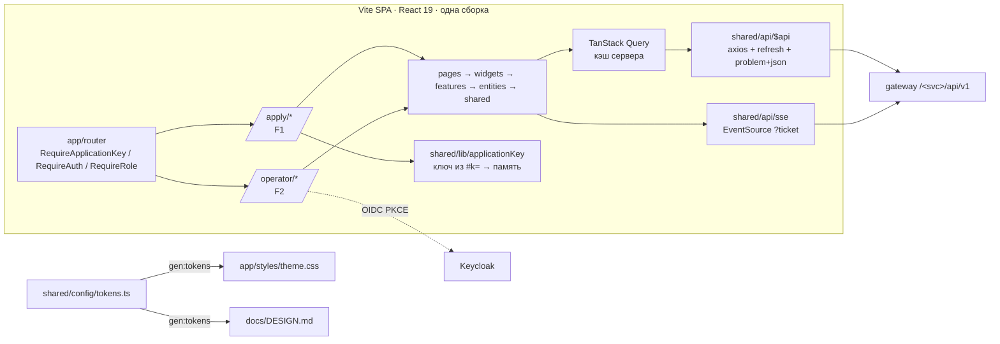

# ARCHITECTURE — frontend

Общая архитектура системы — `../../docs/ARCHITECTURE.md`. Правила слоёв FSD — скилл `frontend-fsd` (§1–2), адаптация — `frontend-fsd/references/adaptation.md`. Здесь — устройство нашего приложения (повторяет «Проходную», ADR-012).

## Схема


## Потоки
**Комплект (кабинет, F1).** `start-application`: `POST /intake/api/v1/applicant/applications {consent}` → `{applicationId, accessKey, resumeCode}` → ссылка `/apply/<id>#k=<key>` (ключ во фрагменте не уходит на сервер в логах) → `fill-profile` (`PUT …/profile`) → `requiredTypes` → `DocumentChecklist`. `upload-document`: `POST …/documents` (multipart, `slotType` — только чтобы показать в пункте) → ответ `202` сразу рисуем карточку `RECEIVED`; отказ 4xx → текст и подсказка из problem+json прямо в пункте. Стадии: `GET …/stream/ticket` → `EventSource(…/stream?ticket=)` → `invalidateQueries(['application', id])`. `TYPE_MOVED` → карточка «переехала» в правильный пункт (`layout`-анимация). Итог «не хватает X» — из ответа бэка (`missingTypes`), а не вычисляется на клиенте.

**Камера (F1).** `capture-document`: `getUserMedia({facingMode: 'environment'})`, рамка документа, подсказки «ближе / свет / без бликов» — только советы; снимок → JPEG → тот же `upload-document`. Решение о пригодности — на сервере.

**Сверка (оператор, F2).** `OperatorQueue` (фильтры в URL, курсоры) → `take-next` (`POST /review/api/v1/operator/queue/next`) → `ApplicationReviewPage`: `DocumentViewer` (страницы через `/intake/api/v1/files/{id}/content`, blob URL, зум/поворот, слой bbox из результата) + `FieldsPanel` (поля, уверенность, проверки; поля «перепроверить» сверху). Клик по полю → подсветка bbox на странице. `correct-field` / `correct-type` / `confirm-document` / `request-resubmit` / `reprocess-document` / `decide-application` — мутации + `invalidateQueries`. Горячие клавиши: `J/K` — поле, `Enter` — подтвердить, `E` — править, `N` — следующая заявка.

**Realtime.** `/review/api/v1/operator/stream` → очередь и карточка без перезагрузки; `/intake/…/stream` — стадии соискателю. Переподключение с backoff и `Last-Event-ID`.

## Стек
React 19, TypeScript strict, Vite, npm · Tailwind 4 + shadcn/ui (Radix, cva) · motion (`motion/react`) · TanStack Query · axios · zustand · react-hook-form + zod · i18next · react-hot-toast · React Router · `oidc-client-ts` · `react-dropzone` · `pdfjs-dist` (Apache-2.0, просмотр PDF) · `react-zoom-pan-pinch` · recharts · lucide-react · MSW (только dev). Версии и лицензии — `../../docs/STACK.md`, `../../docs/DECISIONS.md`.

## Структура папок
```
frontend/
  AGENTS.md  CLAUDE.md  docs/
  package.json  vite.config.ts  components.json  index.html
  public/locales/ru/<namespace>.json
  src/
    app/        providers/(router, query, auth, theme, motion), styles/theme.css (генерируется), main.tsx
    pages/      Apply*Page (F1) · Operator*Page (F2) · NotFoundPage, ForbiddenPage
    widgets/    DocumentChecklist, UploadSlot, DocumentStatusCard, CameraCapture, CompletenessSummary (F1)
                · OperatorSidebar, OperatorQueue, DocumentViewer, FieldsPanel, CrossCheckPanel, HistoryTimeline, QueueMetrics, ModelStatusBadge (F2)
    features/   start-application, fill-profile, upload-document, capture-document, replace-file, remove-file (F1)
                · take-next, correct-field, correct-type, confirm-document, request-resubmit, reprocess-document, decide-application, export-expiring, export-hr-card (F2)
    entities/   Session, Application, ApplicantProfile, Document (stageView, reasonView), DocType, ParsedField, Finding, HistoryEntry
    shared/
      api/      $api (axios), schema.ts (gen:api, не коммитим), sse.ts, problem.ts
      config/   tokens.ts (ЕДИНЫЙ источник стиля), motion.ts, env.ts
      const/    router.ts (AppRoutes, getRoute*)
      lib/      utils.ts (cn), applicationKey.ts, image.ts (сжатие снимка), theme/
      hooks/    useOnline, useEventStream, useCamera, useHotkeys
      ui/       <Comp>/<Comp>.tsx — shadcn + кастомные контролы
    mocks/      MSW, только dev
```
Импорты — только вниз по слоям, чужой слайс — через `index.ts` (проверяет `fsd-check`).

## Ключевые решения
ADR-006 (тип не из пункта), ADR-008 (ключ заявки), ADR-009 (SSE), ADR-012 (дизайн-система и стек — как в «Проходной»). Локальные решения модуля — `MEMORY.md` §3.
