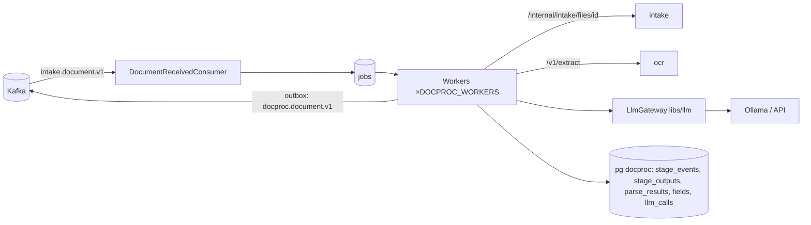

# ARCHITECTURE — docproc

Система целиком — `../../../docs/ARCHITECTURE.md`, контракт — `../../../docs/API.md`, раскладка Java-сервиса — скилл `backend-spring`.
## Схема


## Поток задания
1. Консьюмер: `insert into jobs … on conflict (document_id) do nothing` → `QUEUED` (идемпотентно); `FileReplaced` → новая версия, задание сбрасывается на EXTRACTING_TEXT.
2. Воркер захватывает задание (`for update skip locked`, lease), продлевает lease каждые 30 с.
3. `StageMachine` выполняет текущую стадию; выход стадии → `stage_outputs`; переход → `stage_events` + outbox `StageChanged` — одна транзакция.
4. EXTRACTING_TEXT: файл из intake → ocr (`text`, `words[bbox, conf]`, `quality`, `mrz?`); качество ниже порога → UNREADABLE с `reasonCode`.
5. CLASSIFYING: промпт `classify.v<N>` + реестр типов → `{type, confidence, evidence}`; ниже `CLASSIFY_MIN_CONFIDENCE` → `TYPE_UNKNOWN` (оператор).
6. EXTRACTING_FIELDS: `extract.v<N>` + JSON Schema типа (+ изображение, если vision) → поля; невалидно по схеме → 1 перегенерация → `MODEL_INVALID_OUTPUT`.
7. VALIDATING: `FieldNormalizer` + `FieldChecks` (MRZ, контрольные суммы, даты, срок) → `checks[]`; `ConfidenceScorer` → уверенность; есть поле ниже порога или провал проверки → NEEDS_REVIEW, иначе PARSED.
8. `parse_results` + `fields` + outbox `DocumentParsed` (с `model`, `prompt_version`, `schema_version`).

## Стек
Spring Boot 3.5, jOOQ, Liquibase, Spring Kafka, `libs/llm`, networknt json-schema-validator, Resilience4j, Micrometer.

## Структура папок
```
docproc/
  build.gradle.kts
  src/main/java/ru/documents/docproc/
    api/         DocumentsApi (result, reprocess), ModelApi (status), InternalApi
    queue/       JobRepository, JobClaimer, LeaseKeeper, WorkerPool, Backoff
    pipeline/    StageMachine, stages/ (ExtractText, Classify, ExtractFields, Validate)
    ocr/         OcrClient
    classify/    Classifier, TypeRegistry (doc_types)
    extract/     FieldExtractor, SchemaValidator
    validate/    FieldNormalizer, checks/ (MrzCheck, SnilsCheck, InnCheck, DateCheck, ExpiryCheck), ConfidenceScorer
    events/      DocumentReceivedConsumer
  src/main/resources/prompts/          # classify.v1.md, extract.v1.md (версия в результате)
  src/main/resources/db/changelog/     # jobs, stage_events, stage_outputs, parse_results, fields, doc_types (+ 8 схем), llm_calls
  src/test/java/…/queue/               # RestartMidStageTest, ConcurrentClaimTest, WaitingModelTest
```

## Данные
`jobs`, `stage_events`, `stage_outputs`, `parse_results`, `fields`, `doc_types(code, name, schema, version)`, `llm_calls`, `outbox`, `processed_events` (ARCHITECTURE системы §Модель данных).

## События
Слушает `intake.document.v1`. Публикует `docproc.document.v1`: `StageChanged`, `DocumentParsed`, `DocumentUnreadable`, `DocumentFailed`.

## Зависимости
intake (`/internal/intake/files/{id}`), ocr (`/v1/extract`), `LlmGateway` (Ollama или API). Все — с таймаутом и circuit breaker.

## Конфигурация
`DOCPROC_WORKERS`, `JOB_LEASE`, `JOB_MAX_ATTEMPTS`, `OCR_URL`, `OCR_MIN_CONFIDENCE`, `CLASSIFY_MIN_CONFIDENCE`, `FIELD_REVIEW_THRESHOLD`, `VISION_FALLBACK_ENABLED`, `LLM_*` (LLM.md).
