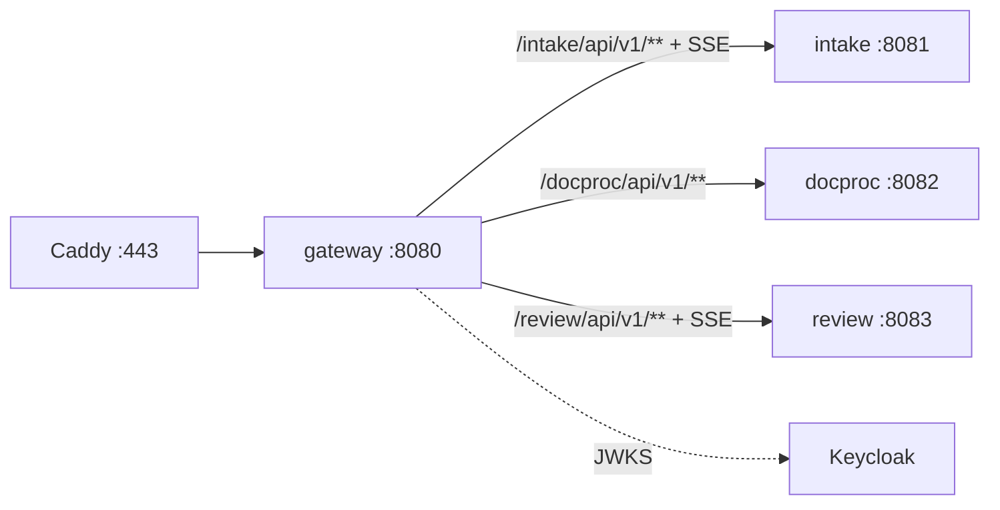

# ARCHITECTURE — gateway

Система целиком — `../../../docs/ARCHITECTURE.md`, контракт — `../../../docs/API.md`, раскладка Java-сервиса — скилл `backend-spring`.
## Схема


## Поток
1. Caddy терминирует TLS → gateway.
2. Фильтр: `/internal/**` → 404; CORS; лимит тела; rate-limit.
3. Путь соискателя (`/intake/api/v1/applicant/**`) — без JWT, ключ заявки проверяет intake; всё остальное — JWT Keycloak (issuer → JWKS). Роли здесь не проверяем.
4. `traceparent` (если нет) и `X-Request-Id`, переписывание пути, проксирование.
5. Ошибки самого gateway — problem+json (`UNAUTHORIZED`, `RATE_LIMITED`, `PAYLOAD_TOO_LARGE`, `UPSTREAM_UNAVAILABLE`).

## Стек
Spring Boot 3.5 WebFlux, Spring Cloud Gateway 2025.0, spring-security oauth2-resource-server, Micrometer Tracing + OTel, Bucket4j/Resilience4j (rate-limit).

## Структура папок
```
gateway/
  AGENTS.md CLAUDE.md docs/
  build.gradle.kts                  # plugin documents.gateway
  src/main/java/ru/documents/gateway/
    config/    RoutesConfig, SecurityConfig, CorsConfig
    filter/    InternalPathBlockFilter, RateLimitFilter, RequestIdFilter, BodyLimitFilter
    exception/ GatewayErrorHandler (problem+json)
  src/main/resources/application.yml   # INTAKE_URL, DOCPROC_URL, REVIEW_URL
  src/test/java/ru/documents/gateway/  # RoutesIntegrationTest, InternalBlockedTest, PublicPathsTest
```

## Данные
Своей БД нет. Счётчики rate-limit в памяти (теряются при рестарте — допустимо, это не данные).

## События
Не публикует и не слушает.

## Зависимости
Keycloak (JWKS). Upstream: intake, docproc, review.

## Конфигурация (env, значения — `infra/.env.example`)
`OIDC_ISSUER_URI`, `INTAKE_URL`, `DOCPROC_URL`, `REVIEW_URL`, `CORS_ORIGINS`, `UPLOAD_MAX_MB`.
