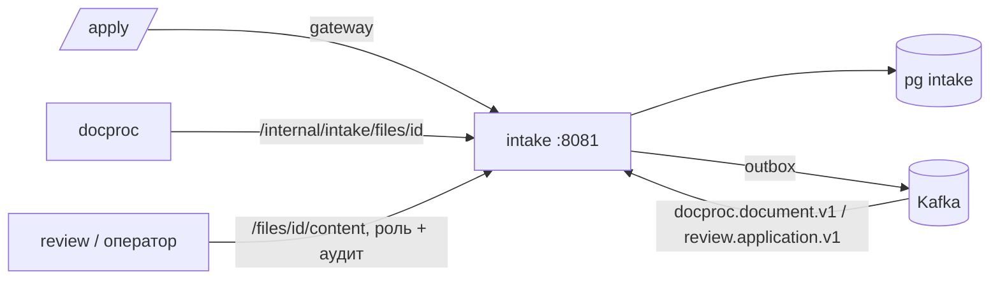

# ARCHITECTURE — intake

Система целиком — `../../../docs/ARCHITECTURE.md`, контракт — `../../../docs/API.md`, раскладка Java-сервиса — скилл `backend-spring`.
## Схема


## Поток приёма
1. `POST /applicant/applications/{id}/documents` (multipart, `slotType?`) — ключ заявки из `Authorization: Applicant <accessKey>` → sha256 → заявка; `APPLICATION_LOCKED`, если уже на решении.
2. `FileInspector` (цепочка проверок, каждая — свой класс и тест): `EmptyCheck` → `SizeCheck` → `SignatureCheck` (Apache Tika detect по байтам) → `IntegrityCheck` (PDFBox open / ImageIO decode / HEIC через TwelveMonkeys) → `EncryptedPdfCheck` → `PageCountCheck` → `ResolutionCheck` → `DuplicateCheck` (sha256 в заявке; pHash — предупреждение).
3. Одна транзакция: `document_files` (AES-GCM) + `documents(stage=RECEIVED)` + outbox `DocumentReceived`.
4. `202 {documentId, stage}`; стадии дальше приходят из `docproc.document.v1` → `documents.stage` → SSE.
5. `slotType` хранится, но **в событие для классификатора не идёт** (ADR-006); несовпадение типа → `TYPE_MOVED`.

## Стек
Spring Boot 3.5 (web, security resource server, validation, actuator), jOOQ, Liquibase, Spring Kafka, Apache Tika core (detect), PDFBox, TwelveMonkeys ImageIO, Bouncy Castle не нужен (JCA AES-GCM).

## Структура папок
```
intake/
  build.gradle.kts                      # plugin documents.service
  src/main/java/ru/documents/intake/
    api/        ApplicantApi(+Impl), FilesApi, InternalFilesApi, dto/ (Rq/Rs)
    application/ ApplicationService, DocumentService, ProfileService, RequirementsService
    inspect/    FileInspector, checks/*Check, InspectionResult
    storage/    FileCrypto (AES-GCM), FileRepository
    access/     ApplicationKeyFilter, ApplicationKeyHasher
    events/     DocprocEventsConsumer, ReviewEventsConsumer
    sse/        ApplicantStreamService
  src/main/resources/db/changelog/      # applicants, applications, documents, document_files, doc_requirements, outbox, processed_events
  src/test/java/…/inspect/              # по тесту на каждую проверку + FileInspectorTest на наборе битых файлов
```

## Данные
`applicants`, `applications(profile jsonb, status, access_key_hash, resume_code_hash)`, `documents(slot_type?, current_file_id, stage, detected_type?)`, `document_files(version, sha256, phash, mime, size, pages, content_enc, nonce)`, `doc_requirements(profile_rule jsonb, doc_type, required)`, `outbox`, `processed_events`.

## События
Публикует `intake.application.v1` (`ApplicationCreated/ProfileChanged/Submitted/ApplicationDeleted`), `intake.document.v1` (`DocumentReceived/FileReplaced/DocumentRemoved`). Слушает `docproc.document.v1` (стадии, тип), `review.application.v1` (`ResubmitRequested`, `ApplicationDecided`).

## Зависимости
Keycloak (JWKS операторов и service accounts). Сам никого не вызывает синхронно.

## Конфигурация
`UPLOAD_MAX_MB`, `UPLOAD_MAX_PAGES`, `UPLOAD_MAX_FILES`, `IMAGE_MIN_PX`, `FILES_ENCRYPTION_KEY`, `DB_*`, `KAFKA_BOOTSTRAP`.
