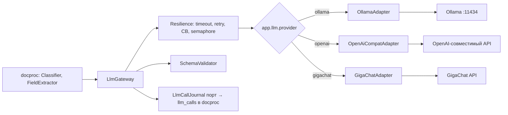

# ARCHITECTURE — libs/llm

Система целиком — `../../../../docs/ARCHITECTURE.md`, контракт — `../../../../docs/API.md`, раскладка Java-сервиса — скилл `backend-spring`.
## Схема


## Стек
Java 21, Spring Boot autoconfigure, `RestClient` (без SDK — HTTP-API провайдеров напрямую), Jackson, networknt json-schema-validator, Resilience4j, Micrometer.

## Структура папок
```
libs/llm/
  build.gradle.kts                     # plugin documents.library
  src/main/java/ru/documents/llm/
    LlmGateway.java  ChatMessage.java  ChatResult.java  LlmStatus.java  LlmException.java
    LlmCallJournal.java                # порт, реализует docproc
    core/      ResilientLlmGateway, SchemaValidator, Prompts (загрузка версионированных промптов)
    infra/ollama/  infra/openai/  infra/gigachat/
    config/    LlmAutoConfiguration, LlmProperties
  src/test/java/ru/documents/llm/      # адаптеры на WireMock, LlmIsolationTest (ArchUnit), SchemaValidatorTest
```

## Данные
Нет своих таблиц; журнал пишет сервис через `LlmCallJournal`.

## События
Нет.

## Зависимости
Внешние: Ollama (compose, профиль `llm-local`) или API провайдера. Ключи — только из env.

## Конфигурация
`LLM_PROVIDER`, `LLM_BASE_URL`, `LLM_MODEL`, `LLM_VISION_MODEL`, `LLM_API_KEY`, `LLM_TIMEOUT_SECONDS`, `LLM_MAX_CONCURRENCY`, `GIGACHAT_SCOPE` (`../../../docs/LLM.md`).
