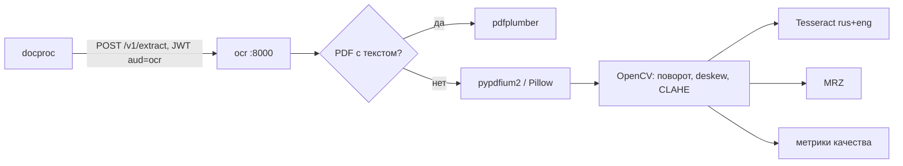

# ARCHITECTURE — ocr

Система целиком — `../../../docs/ARCHITECTURE.md`, контракт — `../../../docs/API.md`, раскладка Python-сервиса — скилл `backend-spring` (раздел Python).
## Схема


## Поток
1. Проверка JWT (JWKS Keycloak, `aud=ocr`), лимит размера.
2. Определение формата по байтам (`python-magic`), разбиение на страницы (≤ `UPLOAD_MAX_PAGES`).
3. Для страницы: текстовый слой → слова с bbox из pdfplumber; иначе рендер 300 dpi → предобработка → Tesseract.
4. Метрики качества: дисперсия Лапласиана (резкость), средняя яркость, доля пересвета (блики), контур документа у края (обрезка).
5. MRZ (если найдена зона) — строки + контрольные цифры.
6. Ответ JSON; ничего не сохраняется.

## Стек
FastAPI, uvicorn, pydantic 2, pdfplumber (MIT), pypdfium2 (Apache-2.0/BSD), Pillow, pillow_heif, opencv-python-headless (Apache-2.0), pytesseract + Tesseract 5 (Apache-2.0), python-magic, PyJWT.

## Структура папок
```
ocr/
  AGENTS.md CLAUDE.md docs/
  pyproject.toml uv.lock Dockerfile     # apt: tesseract-ocr tesseract-ocr-rus
  src/ocr/
    main.py  api/ (extract, health)  auth.py
    pdf.py render.py preprocess.py tesseract.py quality.py mrz.py
    config.py metrics.py
  tests/ test_pdf_text.py test_quality.py test_mrz.py test_rotate.py   # синтетические картинки
```

## Данные
Нет. Stateless; временные файлы только в памяти запроса.

## События
Нет.

## Зависимости
Keycloak (JWKS). Никого не вызывает.

## Конфигурация
`OCR_LANGS=rus+eng`, `OCR_DPI=300`, `OCR_MAX_PAGES`, `OIDC_ISSUER_URI`, пороги метрик качества (по умолчанию в `config.py`, переопределяются env).
