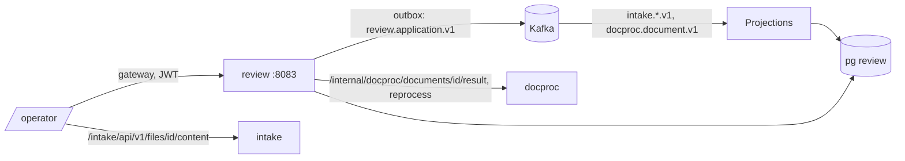

# ARCHITECTURE — review

Система целиком — `../../../docs/ARCHITECTURE.md`, контракт — `../../../docs/API.md`, раскладка Java-сервиса — скилл `backend-spring`.
## Схема


## Поток сверки
1. Проекции наполняют `queue_items` из `ApplicationSubmitted`, `StageChanged`, `DocumentParsed`.
2. `POST /operator/queue/next` — назначение (`assignments`, `for update skip locked`) → карточка.
3. Карточка: результат docproc (кэш в `queue_items.result jsonb`) + `field_overrides` + `findings`.
4. Правка → `field_overrides` + `application_history` + outbox `FieldCorrected` — одна транзакция.
5. Решение → `decisions` + `ApplicationDecided` (intake показывает соискателю).

## Стек
Spring Boot 3.5, jOOQ, Liquibase, Spring Kafka, Apache POI (XLSX/DOCX, Apache-2.0), OpenPDF (LGPL/MPL — проверить, иначе только DOCX/XLSX), Micrometer.

## Структура папок
```
review/
  build.gradle.kts
  src/main/java/ru/documents/review/
    api/        QueueApi, CardApi, ActionsApi, HistoryApi, ReportsApi, MetricsApi, StreamApi
    queue/      QueueService, AssignmentService
    card/       CardService, FieldOverrideService
    crosscheck/ CrossDocumentChecker, NameMatcher (транслитерация ГОСТ 52535.1/ICAO)
    history/    HistoryService                 # append-only, триггер в БД
    reports/    ExpiringDocumentsReport, HrCardExport
    metrics/    QueueMetricsService
    masking/    PiiMasker (AUDITOR)
    events/     IntakeConsumer, DocprocConsumer
  src/main/resources/db/changelog/             # queue_items, assignments, field_overrides, application_history(+trigger), findings, decisions
  src/test/java/…/                              # RoleMatrixTest, HistoryAppendOnlyTest, CrossDocumentCheckerTest
```

## Данные
`queue_items`, `assignments`, `field_overrides`, `application_history` (append-only), `findings`, `decisions`, `outbox`, `processed_events`.

## События
Слушает `intake.application.v1`, `intake.document.v1`, `docproc.document.v1`. Публикует `review.application.v1`: `FieldCorrected`, `TypeCorrected`, `DocumentConfirmed`, `ResubmitRequested`, `ApplicationDecided`.

## Зависимости
docproc (`/internal/docproc/documents/{id}/result`, `reprocess`). Файлы оператор берёт сам из intake (`/files/{id}/content`).

## Конфигурация
`EXPIRING_DAYS` (по умолчанию 30), `ASSIGNMENT_TTL_MINUTES`, `DOCPROC_URL`, `DB_*`, `KAFKA_BOOTSTRAP`.
