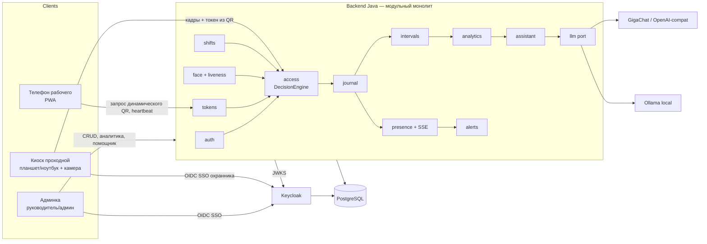
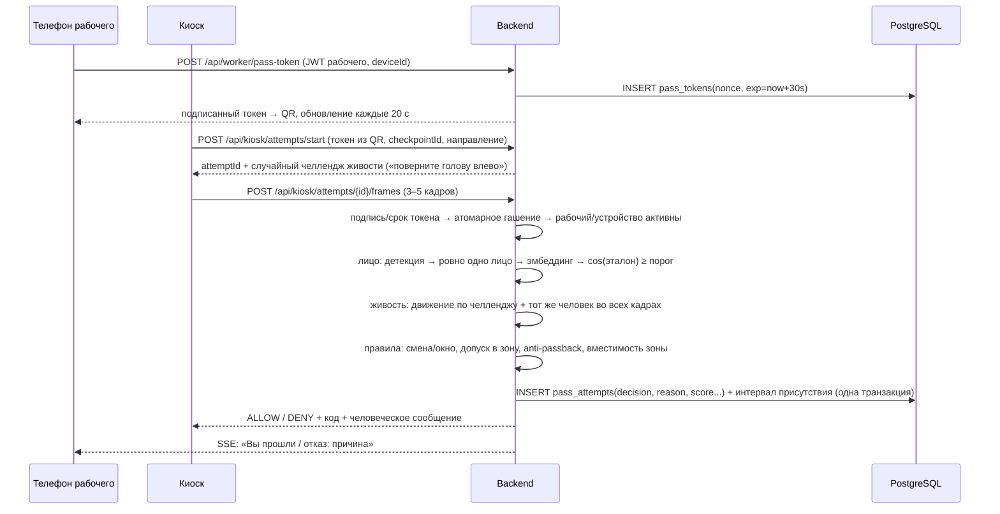
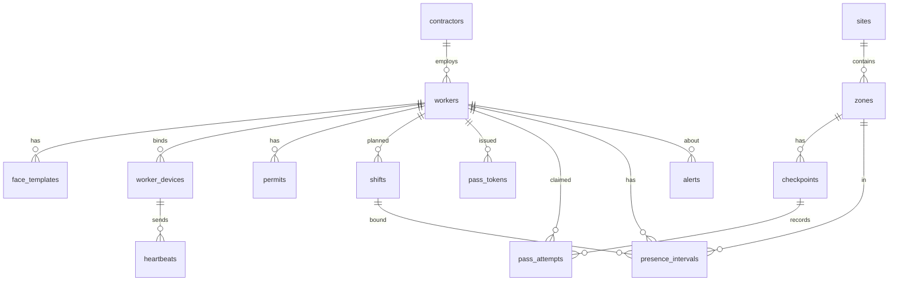

# Архитектура

## Контекст

## Сценарий прохода (ядро, 28 баллов + допуск)

Порядок проверок в `DecisionEngine` (fail-fast, первая проваленная проверка и есть причина; всё, что успели посчитать, пишем в журнал):
1. Проходная известна и активна, запрос подписан ключом киоска.
2. Токен: формат → подпись → срок → **атомарное гашение** (`UPDATE ... WHERE used_at IS NULL AND expires_at > now()`) → совпадение устройства.
3. Рабочий существует, не заблокирован, у устройства статус ACTIVE.
4. Лицо: качество → одно лицо → совпадение с эталоном именно этого рабочего.
5. Живость.
6. Смена: есть плановая смена, текущее время в окне `[start − 60 мин; end]` (настраивается).
7. Допуск: инструктаж ТБ/медосмотр не просрочен, есть допуск в зону.
8. Anti-passback: вход разрешён только из состояния «снаружи», выход только из «внутри».
9. Вместимость зоны (опционально).

## Модули backend
| Модуль | Ответственность | Ключевые сущности |
|---|---|---|
| auth | логин, JWT, роли, сопряжение киоска | users, kiosk_devices |
| people | рабочие, подрядчики, допуски | workers, contractors, permits |
| devices | привязка телефона к рабочему, инвайт-коды | worker_devices, invites |
| face | эталоны, эмбеддинги, сравнение, живость | face_templates |
| tokens | выдача и гашение динамических пропусков | pass_tokens |
| access | движок решений, проходные, зоны | checkpoints, zones, sites |
| journal | неизменяемый журнал попыток, аудит действий админа | pass_attempts, audit_log |
| shifts | плановые смены, шаблоны графика | shifts, shift_templates |
| intervals | интервалы присутствия по зонам, автозакрытие | presence_intervals |
| presence | текущая обстановка, SSE, heartbeat телефона | heartbeats |
| alerts | правила оповещений, напоминания | alerts |
| analytics | отчёты, метрики, табель, выгрузки | (views/SQL) |
| llm | порт + адаптеры провайдеров | — |
| assistant | инструменты, валидатор чисел, проактивные аномалии | assistant_log |

## Модель данных (минимум)

Ключевые поля:
- `pass_attempts(id, ts, checkpoint_id, direction, claimed_worker_id, token_nonce, face_score, liveness_ok, decision, reason_code, details jsonb, snapshot bytea, latency_ms, source)` — append-only, без UPDATE/DELETE.
- `presence_intervals(id, worker_id, zone_id, shift_id, entered_at, exited_at, close_reason[EXIT|ZONE_CHANGE|AUTO_SHIFT_END|MANUAL], flags[])`.
- `pass_tokens(nonce uuid pk, worker_id, device_id, issued_at, expires_at, used_at, used_attempt_id)`.
- `face_templates(id, worker_id, embedding real[128], model_version, quality, photo bytea, created_by, created_at)`.

## Алгоритм интервалов (смена и перемещения, 10 баллов)
- Вход на площадку открывает интервал в зоне проходной. Проход через внутреннюю проходную зоны закрывает текущий интервал (`ZONE_CHANGE`) и открывает новый. Выход закрывает интервал (`EXIT`).
- Интервал привязывается к смене, окно которой пересекается со временем входа, включая ночные смены через полночь. Смены нет — интервал помечается `NO_SHIFT`.
- Нет выхода к `shift_end + 2 ч` — автозакрытие `AUTO_SHIFT_END` с флагом `UNCONFIRMED_EXIT`. Такие интервалы в отчётах не считаются молча: показываются отдельно.
- Отработано = Σ пересечений интервалов с окном смены. Опоздание = max(0, первый вход − плановое начало − допуск). Переработка = max(0, последний выход − плановый конец − допуск).

## Безопасность
Подробно: SECURITY.md (Keycloak, модель угроз, шифрование, аудит). Кратко:
- Персонал входит через Keycloak SSO: ADMIN (всё, TOTP), MANAGER (обстановка, аналитика, помощник — чтение), SECURITY_OFFICER (аудит, целостность журнала, TOTP), GUARD (киоск, ручной проход с причиной).
- Киоск: охранник входит через SSO + киоск подписывает каждый запрос своим ключом устройства (сопряжение кодом из админки).
- Телефон рабочего: инвайт-QR → неизвлекаемый ключ ECDSA в браузере → device-токены ES256 на 10 мин. Новый телефон = перепривязка админом.
- Rate-limit: 5 неудачных сверок лица по рабочему за 10 мин → временная блокировка и оповещение.
- Фото и эмбеддинги отдаются только ADMIN. Миниатюры в журнале — по отдельному эндпоинту с проверкой роли.

## Почему не микросервисы (ADR-010)
Монолит с модулями + отдельные инфраструктурные сервисы (Keycloak, PostgreSQL, Ollama, Caddy) — это уже 6–7 контейнеров, и условие Д2 «отдельный бэкенд» выполнено. Микросервисы на один день ломают главное свойство безопасности: **гашение токена, решение и запись в журнал идут в одной транзакции БД**. В микросервисах это превращается в распределённую транзакцию (saga), появляются межсервисная аутентификация, сетевые отказы и сложная отладка, а баллов за это нет. Границы модулей проверяются ArchUnit, поэтому любой модуль (например `face`) выносится в сервис без переписывания — так и отвечаем судьям.
