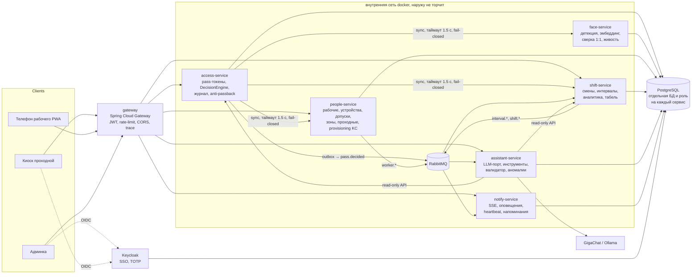
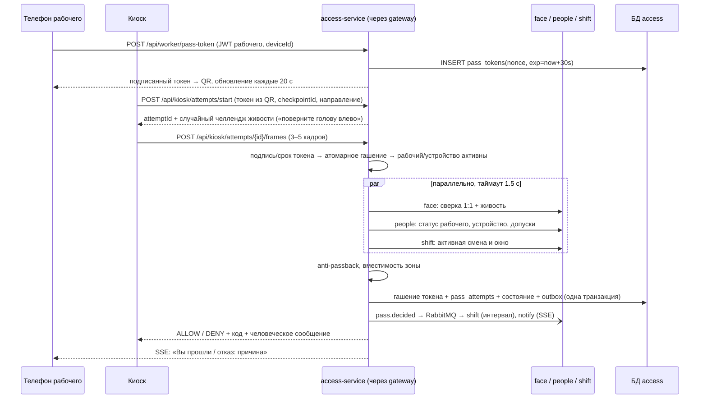
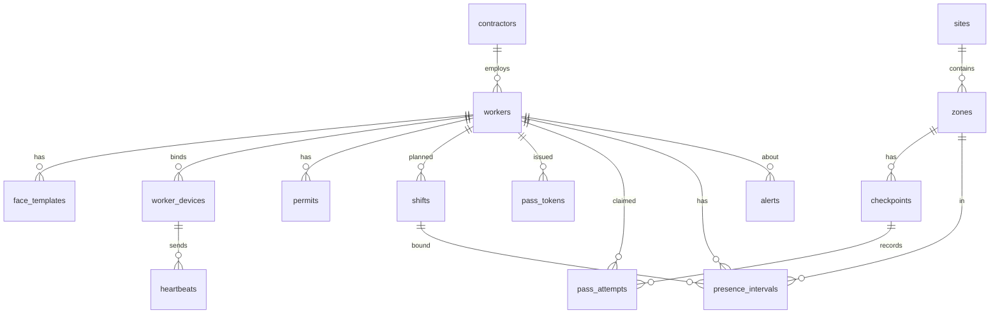

# Архитектура

## Контекст: микросервисы

### Сервисы
| Сервис | Ответственность | Своя БД | Публикует | Слушает | Владелец |
|---|---|---|---|---|---|
| **gateway** | единая точка входа, проверка JWT (Keycloak + device-издатель), rate-limit, CORS, заголовки, `traceparent`, маршрутизация `/api/<service>/**` | — | — | — | B1 |
| **people-service** | рабочие, подрядчики, допуски, устройства и инвайты, device-токены, зоны и проходные, сопряжение киоска, provisioning персонала в Keycloak | `people` | `worker.created/updated/blocked`, `device.bound` | — | B1 |
| **access-service** | выдача и **гашение pass-токенов**, `DecisionEngine`, журнал попыток (hash-chain), anti-passback, состояние «внутри/снаружи», rate-limit попыток | `access` | `pass.decided` (через outbox) | `worker.blocked` | B2 |
| **face-service** | эталоны (шифрованные), детекция YuNet, эмбеддинг SFace, сверка 1:1, челлендж живости. Без состояния, кроме эталонов | `face` | `face.enrolled` | `worker.deleted` | B2 |
| **shift-service** | смены и шаблоны, интервалы присутствия по зонам, автозакрытие, аналитика, табель XLSX | `shift` | `interval.opened/closed`, `shift.missed_exit` | `pass.decided` | B3 |
| **assistant-service** | LLM-порт + адаптеры (GigaChat/OpenAI/Ollama), инструменты (read-only вызовы shift/access), валидатор чисел, проактивные аномалии | `assistant` | `insight.created` | `pass.decided`, `interval.*` | B3 |
| **notify-service** | SSE-хаб для админки, киоска и телефона, правила оповещений (скопления, ушёл с площадки, нет связи), heartbeat телефонов, напоминания о выходе | `notify` | `alert.created` | все события | B3 |

### Почему так нарезано
- **Атомарность прохода внутри access-service.** Гашение токена, решение, запись в журнал, состояние anti-passback и outbox-событие пишутся одной транзакцией. Повтор QR невозможен даже при гонке.
- **Синхронные зависимости прохода** (face, people, shift) вызываются параллельно с таймаутом 1,5 с и circuit breaker. Любой отказ — `DENY SYSTEM_ERROR` (fail-closed) с указанием, какой сервис не ответил.
- **Всё остальное асинхронно** через RabbitMQ: интервалы, обстановка, оповещения, аномалии. Падение shift- или notify-сервиса не мешает проходам; после подъёма они дочитывают очередь.
- **Transactional outbox** (`outbox`-таблица + публикатор) в access и people: событие не теряется при рестарте (Д4) и не публикуется, если транзакция откатилась.
- **Идемпотентные потребители**: таблица `processed_events(event_id)` в каждом слушающем сервисе.

### Межсервисная безопасность (zero-trust)
- Наружу открыт только `caddy → gateway` (+ Keycloak на `auth.`). Сервисы во внутренней docker-сети без проброшенных портов.
- Каждый сервис **сам** проверяет JWT (не доверяет gateway вслепую): пользовательский токен прокидывается дальше; межсервисные вызовы — токен service account из Keycloak (client credentials) с `aud=<целевой сервис>`.
- У каждого сервиса своя роль в PostgreSQL с доступом только к своей БД; у access роль без UPDATE/DELETE на журнал.
- RabbitMQ: отдельный пользователь на сервис, права только на свои exchange/queue.

### Наблюдаемость
OpenTelemetry (Micrometer Tracing) во всех сервисах → **Jaeger**: один проход виден как трейс gateway → access → face/people/shift → rabbit → shift/notify. Метрики Prometheus, JSON-логи с `traceId`. На защите показываем трейс прохода — это сильный аргумент в «инженерной культуре».

## Сценарий прохода (ядро, 28 баллов + допуск)

Порядок проверок в `DecisionEngine` (fail-fast, первая проваленная проверка и есть причина; всё, что успели посчитать, пишем в журнал):
1. Проходная известна и активна, запрос подписан ключом киоска.
2. Токен: формат → подпись → срок → **атомарное гашение** (`UPDATE ... WHERE used_at IS NULL AND expires_at > now()`) → совпадение устройства.
3. Рабочий существует, не заблокирован, у устройства статус ACTIVE.
4. Лицо: качество → одно лицо → совпадение с эталоном именно этого рабочего.
5. Живость.
6. Смена: есть плановая смена, текущее время в окне `[start − 60 мин; end]` (настраивается).
7. Допуск: инструктаж ТБ/медосмотр не просрочен, есть допуск в зону.
8. Anti-passback: вход разрешён только из состояния «снаружи», выход только из «внутри».
9. Вместимость зоны (опционально).

## Внутреннее устройство сервиса
Каждый сервис — Spring Boot 3, пакеты `api` (DTO, клиенты), `domain`, `infra`, `web`, `messaging`. Общее — в библиотеке `services/libs/common`: ProblemDetail-ошибки, конфиг resource server, конвертер ролей Keycloak, outbox, idempotent consumer, AES-GCM, схемы событий. Бизнес-логики в common нет.

## Модель данных (минимум; каждая таблица живёт в БД своего сервиса)

Ключевые поля:
- `pass_attempts(id, ts, checkpoint_id, direction, claimed_worker_id, token_nonce, face_score, liveness_ok, decision, reason_code, details jsonb, snapshot bytea, latency_ms, source)` — append-only, без UPDATE/DELETE.
- `presence_intervals(id, worker_id, zone_id, shift_id, entered_at, exited_at, close_reason[EXIT|ZONE_CHANGE|AUTO_SHIFT_END|MANUAL], flags[])`.
- `pass_tokens(nonce uuid pk, worker_id, device_id, issued_at, expires_at, used_at, used_attempt_id)`.
- `face_templates(id, worker_id, embedding real[128], model_version, quality, photo bytea, created_by, created_at)`.

## Алгоритм интервалов (смена и перемещения, 10 баллов)
- Вход на площадку открывает интервал в зоне проходной. Проход через внутреннюю проходную зоны закрывает текущий интервал (`ZONE_CHANGE`) и открывает новый. Выход закрывает интервал (`EXIT`).
- Интервал привязывается к смене, окно которой пересекается со временем входа, включая ночные смены через полночь. Смены нет — интервал помечается `NO_SHIFT`.
- Нет выхода к `shift_end + 2 ч` — автозакрытие `AUTO_SHIFT_END` с флагом `UNCONFIRMED_EXIT`. Такие интервалы в отчётах не считаются молча: показываются отдельно.
- Отработано = Σ пересечений интервалов с окном смены. Опоздание = max(0, первый вход − плановое начало − допуск). Переработка = max(0, последний выход − плановый конец − допуск).

## Безопасность
Подробно: SECURITY.md (Keycloak, модель угроз, шифрование, аудит). Кратко:
- Персонал входит через Keycloak SSO: ADMIN (всё, TOTP), MANAGER (обстановка, аналитика, помощник — чтение), SECURITY_OFFICER (аудит, целостность журнала, TOTP), GUARD (киоск, ручной проход с причиной).
- Киоск: охранник входит через SSO + киоск подписывает каждый запрос своим ключом устройства (сопряжение кодом из админки).
- Телефон рабочего: инвайт-QR → неизвлекаемый ключ ECDSA в браузере → device-токены ES256 на 10 мин. Новый телефон = перепривязка админом.
- Rate-limit: 5 неудачных сверок лица по рабочему за 10 мин → временная блокировка и оповещение.
- Фото и эмбеддинги отдаются только ADMIN. Миниатюры в журнале — по отдельному эндпоинту с проверкой роли.

## Схема событий
Exchange `gate.events` (topic). Конверт: `{eventId, type, occurredAt, producer, traceId, payload}`; JSON Schema в `contracts/events/`.
| Событие | Producer | Payload |
|---|---|---|
| `pass.decided` | access | attemptId, workerId, checkpointId, zoneId, direction, decision, reasonCode, ts, source |
| `worker.created / updated / blocked / deleted` | people | workerId, contractorId, status |
| `device.bound` | people | workerId, deviceId |
| `face.enrolled` | face | workerId, quality |
| `interval.opened / closed` | shift | intervalId, workerId, zoneId, shiftId, closeReason |
| `shift.missed_exit` | shift | workerId, shiftId |
| `alert.created` | notify | type, severity, workerId?, zoneId?, details |
| `insight.created` | assistant | text, numbers, sources |
