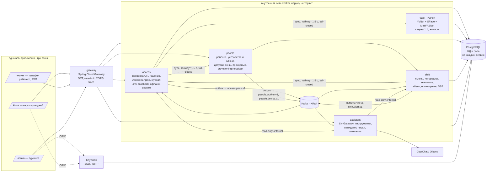
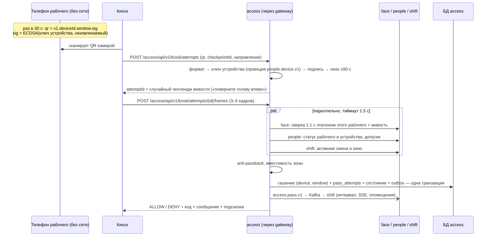
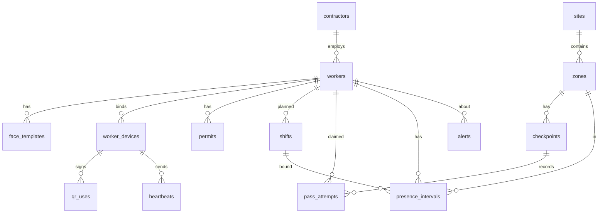

# Архитектура

## Контекст: микросервисы

QR рабочий показывает **без сети**: телефон сам подписывает `deviceId + окно 30 с` ключом устройства (ADR-028). Сеть нужна только киоску до сервера, а сервер может стоять прямо на площадке.

### Сервисы
| Сервис | Ответственность | БД | Публикует (топик) | Слушает | Владелец |
|---|---|---|---|---|---|
| **gateway** | единая точка входа, JWT (Keycloak + device-издатель), rate-limit, CORS, `traceparent`, маршруты `/<svc>/api/v1/**` | — | — | — | B1 |
| **people** | рабочие, подрядчики, допуски, устройства и их публичные ключи, инвайты, device-токены, зоны и проходные, сопряжение киоска, provisioning персонала в Keycloak | `people` | `people.worker.v1`, `people.device.v1` | — | B1 |
| **access** | проверка подписи QR, **атомарное гашение (устройство, окно)**, `DecisionEngine`, журнал попыток (append-only, hash-chain), anti-passback, «внутри/снаружи», подписанный офлайн-снимок для киоска, приём офлайн-журнала | `access` | `access.pass.v1` | `people.device.v1`, `people.worker.v1` | B2 |
| **face** (Python) | эталоны (эмбеддинги, AES-GCM), детекция, эмбеддинг, сверка 1:1, живость (MiniFASNet + челлендж). Решений о проходе не принимает | `face` | — | — | B2 |
| **shift** | смены и шаблоны, интервалы по зонам, автозакрытие, аналитика, табель XLSX, **правила оповещений и SSE-хаб** (бывший notify, ADR-030) | `shift` | `shift.interval.v1`, `shift.alert.v1` | `access.pass.v1`, `people.worker.v1` | B3 |
| **assistant** | `LlmGateway` (GigaChat/OpenAI-совместимый/Ollama), инструменты (read-only `/internal` shift и access), валидатор чисел, проактивные аномалии | `assistant` | `assistant.insight.v1` | `access.pass.v1`, `shift.interval.v1` | B3 |

### Почему так нарезано
- **Атомарность прохода внутри access.** Гашение QR, решение, запись в журнал, anti-passback и outbox — одна транзакция. Повтор QR невозможен даже при гонке (`insert … on conflict do nothing` по `(device_id, window)`).
- **Синхронные зависимости прохода** (face, people, shift) вызываются параллельно с таймаутом 1,5 с и circuit breaker. Любой отказ — `DENY SYSTEM_ERROR` с указанием, какой сервис не ответил.
- **Всё остальное асинхронно** через Kafka: интервалы, обстановка, оповещения, аномалии. Падение shift или assistant не мешает проходам; после подъёма они дочитывают топик со своего offset.
- **Transactional outbox** в people, access, shift: событие не теряется при рестарте (Д4) и не публикуется, если транзакция откатилась. Ключ сообщения — id агрегата (порядок в партиции).
- **Идемпотентные потребители**: `processed_events(event_id)` в каждом слушающем сервисе; 3 повтора → `<topic>.dlt`.
- **Python только там, где он даёт выигрыш** — ONNX-модели лица. Остальное — Java, чтобы любой бэк мог подхватить чужой сервис.

### Межсервисная безопасность (zero-trust)
- Наружу открыт только `caddy → gateway` (+ Keycloak на `auth.`). Сервисы и Kafka во внутренней docker-сети без проброшенных портов.
- Каждый сервис **сам** проверяет JWT; контекст пользователя — только из токена (`CurrentUser`), не из заголовков. Межсервисные вызовы — service account Keycloak (client credentials) с `aud=<целевой сервис>`.
- У каждого сервиса своя роль PostgreSQL с доступом только к своей БД; журнал проходов защищён триггером от UPDATE/DELETE.
- Kafka: один брокер во внутренней сети, `auto.create.topics=false`, топики создаёт `infra/kafka/topics.sh`. SASL/ACL — бонус при наличии времени.

### Наблюдаемость
OpenTelemetry (Micrometer Tracing в Java, `opentelemetry-instrumentation-fastapi` в face) → **Jaeger**: один проход — один трейс gateway → access → face/people/shift → Kafka → shift. `traceparent` кладётся в конверт события. Метрики Prometheus, JSON-логи с `traceId`.

## Сценарий прохода (ядро, 28 баллов + допуск)

### Офлайн-режим киоска (ADR-029, флаг, по умолчанию выключен)
- Киоск раз в час забирает `GET /access/api/v1/kiosk/offline-snapshot`: допущенные рабочие сегодня (id, ФИО, миниатюра, публичные ключи устройств, окно смены, срок допусков), подпись сервера, TTL 12 ч.
- Нет связи с access → баннер «Офлайн-режим». Киоск проверяет подпись QR по снимку и показывает охраннику фото. **Решает охранник** (это ручной проход GUARD с причиной `OFFLINE`), клиент сам `ALLOW` не ставит.
- Записи — в IndexedDB с hash-chain; после восстановления связи `POST /access/api/v1/kiosk/offline-attempts`. Access принимает их с `source=OFFLINE`, гасит (device, window), отмечает конфликты anti-passback для разбора в админке.

Порядок проверок в `DecisionEngine` (fail-fast, первая проваленная проверка и есть причина; всё, что успели посчитать, пишем в журнал):
1. Проходная известна и активна, запрос подписан ключом киоска.
2. QR: формат → устройство известно и ACTIVE → подпись ECDSA → окно времени (±90 с) → **атомарное гашение** `insert into qr_uses(device_id, window) … on conflict do nothing` (0 строк = `QR_ALREADY_USED`).
3. Рабочий существует и не заблокирован (people).
4. Лицо: качество → одно лицо → совпадение с эталоном именно этого рабочего.
5. Живость.
6. Смена: есть плановая смена, текущее время в окне `[start − 60 мин; end]` (настраивается).
7. Допуск: инструктаж ТБ/медосмотр не просрочен, есть допуск в зону.
8. Anti-passback: вход разрешён только из состояния «снаружи», выход только из «внутри».
9. Вместимость зоны (опционально).

## Внутреннее устройство сервиса
Java-сервисы — по скиллу `backend-spring` (взято из certis-api и sueta-rnd-back): `api/controller` (интерфейс) + `impl`, `api/dto/{request *Rq, response *Rs}`, `api/mapper` (MapStruct), `features/<f>/{command, query, application, api, spi, gateway, validator}`, `messaging/{outbox, consumer}`, `exception`, `config`. Общее — `services/libs/common`: ProblemDetail, `ErrorCode`, `CurrentUser`, resource server multi-issuer, `ServiceClients`, `Outbox`/`OutboxRelay`, `IdempotentConsumer`, `EventEnvelope`, `Topics`, `BaseMapperConfig`. Бизнес-логики в common нет. Python-сервис face — `api/ core/ domain/ infra/` (скилл, `references/python-service.md`).

## Модель данных (минимум; каждая таблица живёт в БД своего сервиса)

Ключевые поля:
- `pass_attempts(id, ts, checkpoint_id, direction, claimed_worker_id, device_id, qr_window, face_score, liveness_ok, decision, reason_code, details jsonb, snapshot bytea, latency_ms, source[KIOSK|MANUAL|OFFLINE|SIMULATOR], prev_hash, hash)` — append-only, триггер запрещает UPDATE/DELETE.
- `presence_intervals(id, worker_id, zone_id, shift_id, entered_at, exited_at, close_reason[EXIT|ZONE_CHANGE|AUTO_SHIFT_END|MANUAL], flags[])`.
- `qr_uses(device_id, window bigint, used_at, attempt_id, primary key(device_id, window))` — гашение QR.
- `device_keys(device_id pk, worker_id, public_key bytea, status, updated_at)` — проекция `people.device.v1` в access.
- `face_templates(id, worker_id, embedding_enc bytea /* AES-GCM(real[128]) */, model_version, quality, created_by, created_at)` — в БД face; фото не храним.

## Алгоритм интервалов (смена и перемещения, 10 баллов)
- Вход на площадку открывает интервал в зоне проходной. Проход через внутреннюю проходную зоны закрывает текущий интервал (`ZONE_CHANGE`) и открывает новый. Выход закрывает интервал (`EXIT`).
- Интервал привязывается к смене, окно которой пересекается со временем входа, включая ночные смены через полночь. Смены нет — интервал помечается `NO_SHIFT`.
- Нет выхода к `shift_end + 2 ч` — автозакрытие `AUTO_SHIFT_END` с флагом `UNCONFIRMED_EXIT`. Такие интервалы в отчётах не считаются молча: показываются отдельно.
- Отработано = Σ пересечений интервалов с окном смены. Опоздание = max(0, первый вход − плановое начало − допуск). Переработка = max(0, последний выход − плановый конец − допуск).

## Безопасность
Подробно: SECURITY.md (Keycloak, модель угроз, шифрование, аудит). Кратко:
- Персонал входит через Keycloak SSO: ADMIN (всё, TOTP), MANAGER (обстановка, аналитика, помощник — чтение), SECURITY_OFFICER (аудит, целостность журнала, TOTP), GUARD (киоск, ручной проход с причиной).
- Киоск: охранник входит через SSO + киоск подписывает каждый запрос своим ключом устройства (сопряжение кодом из админки).
- Телефон рабочего: инвайт-QR → неизвлекаемый ключ ECDSA P-256 в браузере (IndexedDB) → публичный ключ в people. Этим же ключом подписывается офлайн-QR; device-токены ES256 на 10 мин — только для онлайн-экранов (профиль, смены). Новый телефон = перепривязка админом.
- Rate-limit: 5 неудачных сверок лица по рабочему за 10 мин → временная блокировка и оповещение.
- Фото и эмбеддинги отдаются только ADMIN. Миниатюры в журнале — по отдельному эндпоинту с проверкой роли.

## Схема событий (Kafka)
Топик `<владелец>.<агрегат>.v<N>`, ключ — id агрегата, partitions 3. Конверт: `{eventId, type, occurredAt, aggregateId, traceparent, payload}`; JSON Schema — `contracts/events/<topic>/<Type>.schema.json`.
| Топик | Типы | Producer | Payload |
|---|---|---|---|
| `access.pass.v1` | `PassDecided` | access | attemptId, workerId, checkpointId, zoneId, direction, decision, reasonCode, ts, source |
| `people.worker.v1` | `WorkerCreated / Updated / Blocked / Deleted` | people | workerId, contractorId, status |
| `people.device.v1` | `DeviceBound / Revoked` | people | deviceId, workerId, publicKey, status |
| `shift.interval.v1` | `IntervalOpened / Closed`, `MissedExit` | shift | intervalId, workerId, zoneId, shiftId, closeReason |
| `shift.alert.v1` | `AlertCreated` | shift | type, severity, workerId?, zoneId?, details |
| `assistant.insight.v1` | `InsightCreated` | assistant | text, numbers, sources |
