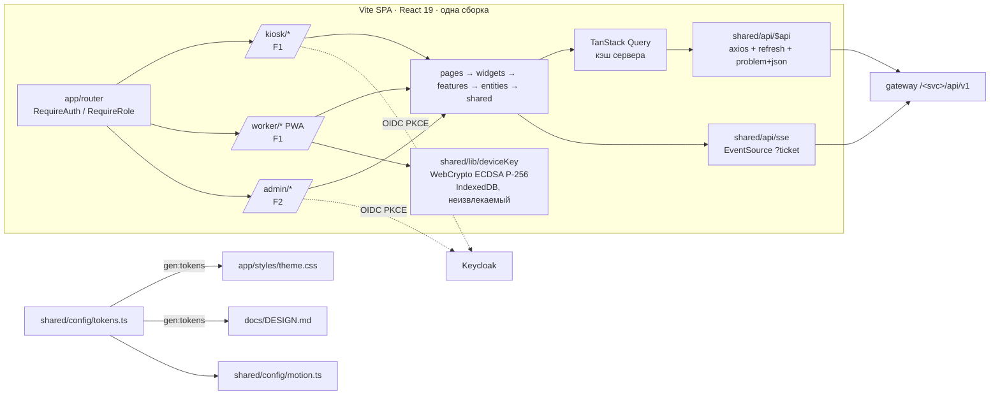

# ARCHITECTURE — frontend

Общая архитектура системы — `../../docs/ARCHITECTURE.md`. Правила слоёв FSD — скилл `frontend-fsd` (§1–2), адаптация — `frontend-fsd/references/adaptation.md`. Здесь — устройство нашего приложения.

## Схема


## Потоки
**Проход (киоск, F1).** `KioskScanner` (`@zxing/browser`) → `scan-pass`: `POST /access/api/v1/kiosk/attempts {qr, direction}` (подпись ключом киоска: `X-Kiosk-Id/X-Ts/X-Nonce/X-Signature`) → ответ сразу DENY или `challenge` → `capture-face` показывает подсказку и снимает 3–5 кадров за окно `motion.kiosk.challengeTimeoutMs` → `POST …/attempts/{id}/frames` → `DecisionScreen` рисует `decision/code/message/hint` **как пришло** (цвет и иконка — `entities/PassDecision/model/consts/reasonView.ts` по `code`) → автосброс через `motion.kiosk.resultHoldMs`. Сеть пропала → баннер; при флаге `OFFLINE_MODE_ENABLED` — экран ручного решения охранника (ADR-029).

**QR (телефон, F1).** Активация: `POST /people/api/v1/auth/worker/activate {inviteCode, deviceId, publicKeyJwk}` → приватный ключ остаётся в IndexedDB. Каждые 30 с `show-pass-qr` подписывает `v1|deviceId|window` и рисует `qrcode.react` — без сети. Онлайн-экраны берут device-токен (challenge → ES256 10 мин, в памяти).

**Заведение человека (админка, F2).** `create-worker` (форма rhf+zod) → `upload-face` (вебкамера, 1–3 кадра, ответ `quality`) → `POST /workers/{id}/invite` → QR инвайта на экране → `create-shift` на сегодня. Цель ≤ 2 мин (Д9).

**Realtime.** `GET /shift/api/v1/stream/ticket` → `EventSource(/shift/api/v1/stream/situation?ticket=)` → `useEventStream` → `invalidateQueries`. Переподключение с backoff и `Last-Event-ID`.

## Стек
React 19, TypeScript strict, Vite, npm · Tailwind 4 + shadcn/ui (Radix, cva) · motion (`motion/react`) · TanStack Query · axios · zustand · react-hook-form + zod · i18next · react-hot-toast · React Router · `oidc-client-ts` · `qrcode.react`, `@zxing/browser` · `vite-plugin-pwa` (`scope: /worker/`) · recharts · lucide-react · MSW (только dev). Версии и лицензии — `../../docs/STACK.md`, `../../docs/DECISIONS.md`.

## Структура папок
```
frontend/
  AGENTS.md  CLAUDE.md  docs/                 ← этот комплект документов
  package.json  vite.config.ts  components.json  index.html
  public/locales/ru/<namespace>.json          тексты (i18next)
  src/
    app/        providers/(router, query, auth, theme, motion), styles/theme.css (генерируется), main.tsx
    pages/      Kiosk*Page, Worker*Page (F1) · Admin*Page (F2) · NotFoundPage, ForbiddenPage
    widgets/    KioskScanner, DecisionScreen, WorkerPassCard (F1) · AdminSidebar, OnSiteNow, PassJournalTable, ShiftTimeline, AssistantChat (F2)
    features/   scan-pass, capture-face, show-pass-qr, activate-device, confirm-manual-pass (F1) · create-worker, upload-face, block-worker, revoke-device, export-timesheet, ask-assistant (F2)
    entities/   Session, Worker, Site, Shift, PassAttempt, PassDecision, Device, Briefing
    shared/
      api/      $api (axios), schema.ts (gen:api, не коммитим), sse.ts, problem.ts
      config/   tokens.ts (ЕДИНЫЙ источник стиля), motion.ts, env.ts
      const/    router.ts (AppRoutes, getRoute*)
      lib/      utils.ts (cn), deviceKey.ts, kioskSign.ts, qr.ts, theme/
      hooks/    useOnline, useEventStream, useCamera
      ui/       <Comp>/<Comp>.tsx — shadcn + кастомные контролы
    mocks/      MSW, только dev
```
Импорты — только вниз по слоям, чужой слайс — через `index.ts` (проверяет `fsd-check`).

## Ключевые решения
ADR-020 (одно приложение FSD), ADR-021 (стек), ADR-028 (офлайн-QR), ADR-029 (офлайн-киоск = ручное решение), ADR-031 (Сбер + только Motion), ADR-033 (единый источник токенов). Локальные решения модуля — `MEMORY.md` §3.
