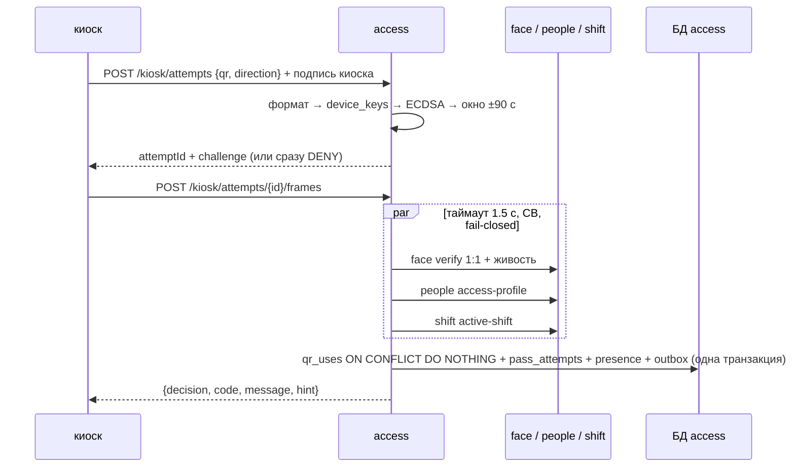

# ARCHITECTURE — access

Система целиком — `../../../docs/ARCHITECTURE.md`, контракт — `../../../docs/API.md`, раскладка Java-сервиса — скилл `backend-spring`.

## Схема


## Поток
1. Проверки QR дешёвые и локальные (проекция `device_keys` из `people.device.v1`) — без сетевых вызовов.
2. Тяжёлые проверки — параллельно через `CompletableFuture` + Resilience4j; любой отказ → `SYSTEM_ERROR` с именем сервиса в `details`.
3. Решение + журнал + outbox `PassDecided` — в одной транзакции; Kafka-публикация асинхронно из outbox.
4. Метрики `pass_attempts_total{decision,reason}`, `pass_decision_seconds`.

## Стек
Spring Boot 3.5, jOOQ + Liquibase, Resilience4j, `RestClient` (service account), Spring Kafka + outbox, Bouncy Castle/JCA (ECDSA P-256).

## Структура папок
```
access/
  AGENTS.md CLAUDE.md docs/
  src/main/java/.../access/
    api/controller/          KioskController(+Impl), AttemptController, SecurityController, WorkerAttemptsController
    features/pass/           command (StartAttempt, SubmitFrames), DecisionEngine, checks/*Check
    features/qr/             QrParser, QrVerifier, QrConsumer (qr_uses)
    features/journal/        HashChain, JournalVerifier
    features/offline/        SnapshotSigner, OfflineAttemptsImporter
    gateway/                 FaceClient, PeopleClient, ShiftClient (timeouts, CB)
    messaging/{outbox,consumer}  PassDecided, DeviceProjectionConsumer, WorkerProjectionConsumer
  src/test/java/.../         DecisionEngineTest, QrVerifierTest, QrConsumeIntegrationTest, FailClosedIntegrationTest, PassAttemptsAppendOnlyIntegrationTest, OutboxIntegrationTest
```

## Данные
`pass_attempts` (append-only, `prev_hash`, `hash`, триггер), `qr_uses(device_id, window) PK`, `attempt_challenges`, `device_keys` (проекция), `worker_state(worker_id, inside, zone_id)` (проекция статуса + anti-passback), `face_failures` (для TEMP_LOCKED), `outbox`, `processed_events`.

## События
Публикует `access.pass.v1` (PassDecided). Слушает `people.device.v1`, `people.worker.v1`.

## Зависимости
face, people, shift — синхронно на проходе (fail-closed). Keycloak — service account.

## Конфигурация (env, значения — `infra/.env.example`)
`FACE_URL`, `PEOPLE_URL`, `SHIFT_URL`, `DEPS_TIMEOUT=1500ms`, `QR_WINDOW_TOLERANCE=90s`, `OFFLINE_MODE_ENABLED=false`, `SNAPSHOT_SIGNING_KEY`.
