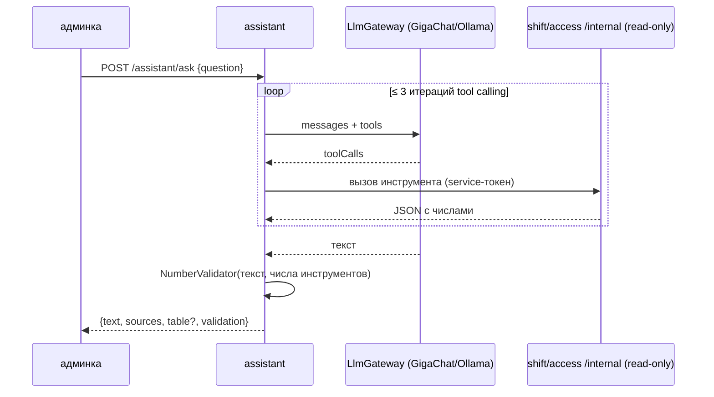

# ARCHITECTURE — assistant

Система целиком — `../../../docs/ARCHITECTURE.md`, контракт — `../../../docs/API.md`, раскладка Java-сервиса — скилл `backend-spring`.

## Схема


## Поток
1. Системный промпт: роль, запрет придумывать числа, только данные инструментов; ПДн — только ФИО и агрегаты.
2. Цикл tool calling ≤ 3 итераций; аргументы инструментов валидируются по JSON-схеме.
3. Валидатор: все числа текста ⊂ числа результатов (+ разрешённые производные, посчитанные сервером) → ok | regenerate (1 раз) | refuse с показом сырых данных.
4. Каждый вызов → `llm_requests` (провайдер, модель, latency, токены, вердикт).

## Стек
Spring Boot 3.5, `RestClient` к API провайдеров (без тяжёлых SDK) или SDK только в `llm.infra` (ArchUnit FR-47), Resilience4j (таймаут 30 с, CB), jOOQ + Liquibase, Spring Kafka (слушает события для инсайтов).

## Структура папок
```
assistant/
  AGENTS.md CLAUDE.md docs/
  src/main/java/.../assistant/
    api/controller/          AssistantController
    features/assistant/command/      AssistantCommandService (цикл tool calling)
    features/assistant/application/tools/   *Tool (имя, JSON-схема, вызов /internal)
    features/assistant/validator/    NumberValidator, NumberExtractor
    features/insights/       AnomalyRules, InsightJob
    llm/                     LlmGateway (порт), ChatRq/ChatRs
    llm/infra/{gigachat,openai,ollama}   адаптеры — единственное место SDK/HTTP провайдеров
    gateway/                 ShiftInternalClient, AccessInternalClient
  src/test/java/.../         NumberValidatorTest, PromptInjectionTest, ArchitectureTest (SDK только в llm.infra)
```

## Данные
`llm_requests(id, ts, provider, model, latency_ms, tokens_in, tokens_out, validation, question_hash)`, `insights(id, text, numbers jsonb, sources jsonb, created_at)`, `processed_events`, `outbox`.

## События
Публикует `assistant.insight.v1`. Слушает `access.pass.v1`, `shift.interval.v1` (для правил аномалий).

## Зависимости
shift и access `/internal/**` (read-only), провайдер LLM. Недоступность — честное сообщение, проходы не затрагиваются.

## Конфигурация (env, значения — `infra/.env.example`)
`LLM_PROVIDER=gigachat|openai|ollama`, `GIGACHAT_AUTH_KEY`, `GIGACHAT_SCOPE`, `OPENAI_BASE_URL`, `OPENAI_API_KEY`, `OLLAMA_URL`, `LLM_MODEL`, `LLM_TIMEOUT=30s`.
