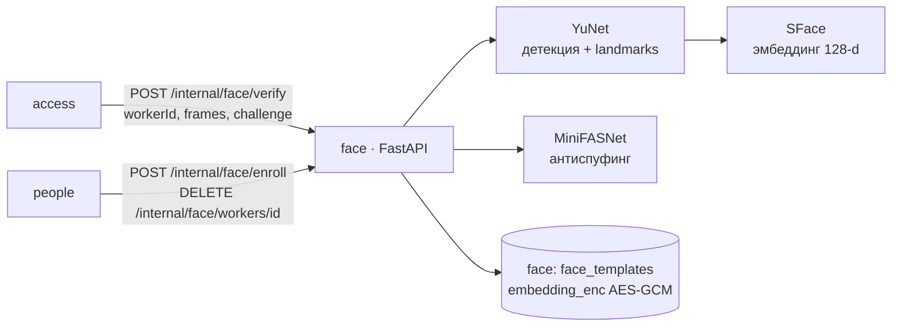

# ARCHITECTURE — face

Система целиком — `../../../docs/ARCHITECTURE.md`, контракт — `../../../docs/API.md`, раскладка Java-сервиса — скилл `backend-spring`.

## Схема


## Поток
1. Проверка service-токена (JWT Keycloak, `aud=face`).
2. Декодирование JPEG base64 (640×480), контроль качества и числа лиц на каждом кадре.
3. Эмбеддинги кадров → сходство между кадрами (тот же человек) → косинус с расшифрованными эталонами рабочего.
4. Челлендж: по 5 точкам YuNet — для TURN_* есть фронтальный кадр и кадр с поворотом носа в нужную сторону (`FACE_YAW_MIN`), для NOD — размах pitch ≥ `FACE_PITCH_DELTA`; окно 10 с держит access. MiniFASNet — FACE-06.
5. Ответ `{match, score, liveness, quality, reason?}`; ничего не логируем кроме score и latency.

## Стек
Python 3.12, uv, FastAPI + uvicorn, pydantic v2, opencv-python-headless (`FaceDetectorYN`, `FaceRecognizerSF` — ONNX через OpenCV DNN), numpy, cryptography (AES-GCM), psycopg 3 + pool, PyJWT (JWKS), prometheus-client, ruff, mypy --strict, pytest. Миграции — `db/migrations/NNN_*.sql`, применяются на старте (`schema_migrations`, advisory lock).

## Структура папок
```
face/
  AGENTS.md CLAUDE.md docs/ pyproject.toml uv.lock Dockerfile
  scripts/fetch_models.sh           # ONNX по URL + sha256 (в образ при сборке, не в git)
  db/migrations/NNN_*.sql
  src/face/
    main.py                         # app() — боевая сборка, create_app() — для тестов
    core/   config.py errors.py security.py
    domain/ model.py quality.py liveness.py matcher.py service.py
    infra/  models.py fetch.py images.py crypto.py repository.py migrate.py
    api/    routes.py schemas.py metrics.py
  tests/unit tests/integration
```

## Данные
`face_templates(id, worker_id, embedding_enc bytea, nonce, model_version, quality, created_by, created_at)`. Фото не храним. Ключ `BIOMETRY_KEY` — из env.

## События
Не публикует и не слушает (вызывается синхронно).

## Зависимости
Только Postgres и Keycloak (JWKS). Модели — локальные файлы.

## Конфигурация (env, значения — `infra/.env.example`)
`BIOMETRY_KEY`, `FACE_MATCH_THRESHOLD`, `FACE_*` (пороги качества и живости, `core/config.py`), `MODELS_DIR`, `DB_HOST`, `DB_PORT`, `FACE_DB_*`, `OIDC_ISSUER_URI`, `OIDC_JWKS_URI?`, `FACE_AUDIENCE`.
