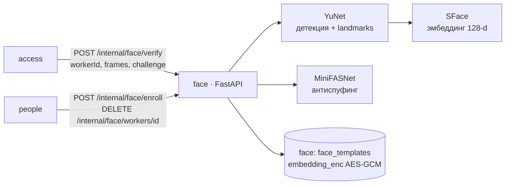

# ARCHITECTURE — face

Система целиком — `../../../docs/ARCHITECTURE.md`, контракт — `../../../docs/API.md`, раскладка Java-сервиса — скилл `backend-spring`.

## Схема


## Поток
1. Проверка service-токена (JWT Keycloak, `aud=face`).
2. Декодирование JPEG base64 (640×480), контроль качества и числа лиц на каждом кадре.
3. Эмбеддинги кадров → сходство между кадрами (тот же человек) → косинус с расшифрованными эталонами рабочего.
4. Челлендж: yaw по landmarks меняется в нужную сторону в пределах окна; MiniFASNet score.
5. Ответ `{match, score, liveness, quality, reason?}`; ничего не логируем кроме score и latency.

## Стек
Python 3.12, uv, FastAPI + uvicorn, pydantic v2, onnxruntime (CPU), opencv-python-headless, numpy, cryptography (AES-GCM), psycopg 3, Liquibase (миграции в `db/changelog`), ruff, mypy --strict, pytest.

## Структура папок
```
face/
  AGENTS.md CLAUDE.md docs/
  pyproject.toml uv.lock Dockerfile
  scripts/download_models.sh        # ONNX по URL + sha256, в образ, не в git
  db/changelog/<ts>-*.sql
  src/face/
    main.py  api/ (verify, enroll, delete, health)  auth.py (JWT service account)
    pipeline/ detect.py embed.py quality.py liveness.py antispoof.py
    storage/ templates.py crypto.py
    config.py metrics.py
  tests/ test_quality.py test_verify.py test_liveness.py test_crypto.py
```

## Данные
`face_templates(id, worker_id, embedding_enc bytea, nonce, model_version, quality, created_by, created_at)`. Фото не храним. Ключ `BIOMETRY_KEY` — из env.

## События
Не публикует и не слушает (вызывается синхронно).

## Зависимости
Только Postgres и Keycloak (JWKS). Модели — локальные файлы.

## Конфигурация (env, значения — `infra/.env.example`)
`BIOMETRY_KEY`, `FACE_THRESHOLD`, `MODELS_DIR`, `DB_*`, `KEYCLOAK_ISSUER`.
