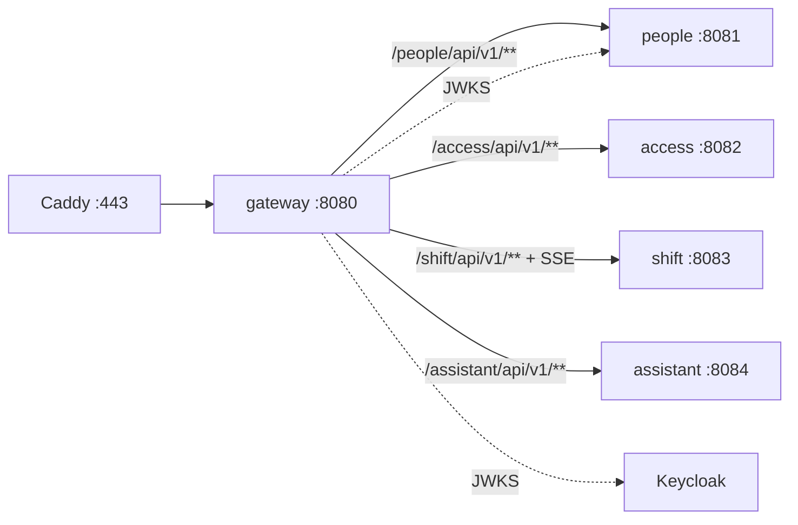

# ARCHITECTURE — gateway

Система целиком — `../../../docs/ARCHITECTURE.md`, контракт — `../../../docs/API.md`, раскладка Java-сервиса — скилл `backend-spring`.

## Схема


## Поток
1. Caddy терминирует TLS → gateway.
2. Фильтр: `/internal/**` → 404; CORS; лимит тела; rate-limit.
3. Проверка JWT (issuer → JWKS), роли не проверяем здесь — это делает сервис.
4. Добавляет `traceparent` (если нет) и `X-Request-Id`, переписывает путь, проксирует.
5. Ошибки самого gateway — problem+json с кодом (`UNAUTHORIZED`, `RATE_LIMITED`, `PAYLOAD_TOO_LARGE`).

## Стек
Spring Boot 3.5 WebFlux, Spring Cloud Gateway 2025.0, spring-security oauth2-resource-server, Micrometer Tracing + OTel, rate-limit — свой фильтр (окно в памяти, ADR-038).

## Структура папок
```
gateway/
  AGENTS.md CLAUDE.md docs/
  build.gradle.kts                  # plugin proxodnaya.gateway
  src/main/java/.../gateway/
    config/   SecurityConfig (multi-issuer, CORS, публичные пути), ClockConfig, properties/GatewayProperties
    filter/   InternalPathBlockFilter, RateLimitFilter, RequestIdFilter
    exception/ Problems (problem+json), UpstreamErrorHandler (503)
  src/main/resources/application.yml   # маршруты через env: PEOPLE_URL, ACCESS_URL, …
  src/test/java/.../                    # GatewayIntegrationTest, InternalPathBlockFilterTest, ArchitectureTest
```

## Данные
Своей БД нет. Состояние — только счётчики rate-limit в памяти (теряются при рестарте — допустимо).

## События
Не публикует и не слушает.

## Зависимости
Keycloak (JWKS), people (JWKS device-токенов). Все сервисы — как upstream.

## Конфигурация (env, значения — `infra/.env.example`)
`OIDC_ISSUER_URI`, `OIDC_JWKS_URI` (по умолчанию `<issuer>/protocol/openid-connect/certs`), `PEOPLE_URL`, `ACCESS_URL`, `SHIFT_URL`, `ASSISTANT_URL`, `CORS_ORIGINS` (через запятую), `MAX_BODY` (5MB), `RATE_LIMIT_CAPACITY` (20), `RATE_LIMIT_WINDOW` (1m), `UPSTREAM_TIMEOUT` (30s). Device-издатель people добавится после PPL-05.
