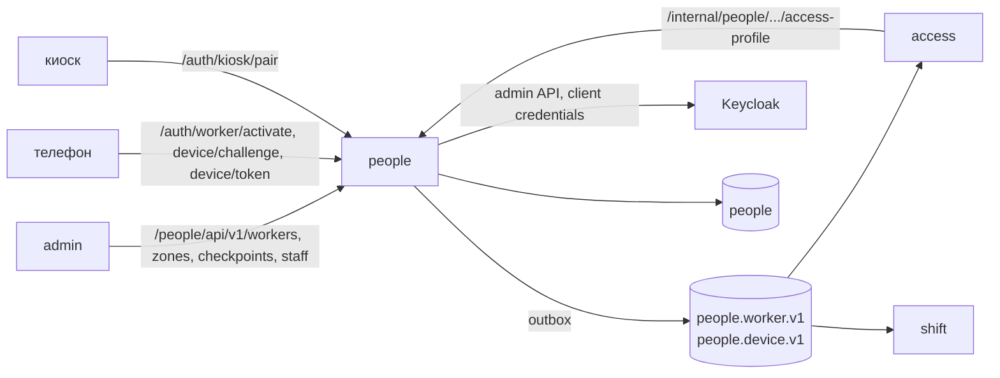

# ARCHITECTURE — people

Система целиком — `../../../docs/ARCHITECTURE.md`, контракт — `../../../docs/API.md`, раскладка Java-сервиса — скилл `backend-spring`.

## Схема


## Поток
1. Админ создаёт рабочего → `WorkerCreated` в outbox (одна транзакция).
2. Админ запрашивает инвайт → одноразовый `inviteCode` (хэш в БД) + QR.
3. Телефон генерирует ключ ECDSA P-256 и вызывает `activate` → `worker_devices` + `DeviceBound` (с публичным ключом) → access строит проекцию `device_keys`.
4. Онлайн-экраны телефона: `challenge` → подпись → device-токен ES256 (ключ сервера из env, JWKS публикуется).
5. Блок/отвязка → `WorkerBlocked`/`DeviceRevoked` → access отказывает со следующего прохода.

## Стек
Spring Boot 3.5 (Web, Security, Validation), jOOQ + Liquibase, Spring Kafka + outbox (`libs/common`), Nimbus JOSE (ES256, JWK), Keycloak Admin REST через `RestClient`.

## Структура папок
```
people/
  AGENTS.md CLAUDE.md docs/
  src/main/java/.../people/
    api/controller/        WorkerController(+Impl), AuthController, ZoneController, CheckpointController, StaffController
    api/dto/{request,response}  *Rq / *Rs
    features/worker/       command, query, validator
    features/device/       activation, challenge, token (DeviceTokenIssuer, JwksController)
    features/site/         зоны, проходные, сопряжение киоска
    features/staff/        KeycloakProvisioner
    messaging/outbox/      WorkerEvents, DeviceEvents
    internal/              AccessProfileController (/internal/people/**)
  src/main/resources/db/changelog/changes/<ts>-*.sql
```

## Данные
`contractors`, `workers(status ACTIVE|BLOCKED|DELETED)`, `permits(type, valid_until)`, `zone_permits`, `worker_devices(device_id, public_key_jwk, status, bound_at)`, `invites(code_hash, expires_at, used_at)`, `device_challenges`, `sites`, `zones(capacity)`, `checkpoints(zone_from, zone_to, kiosk_public_key)`, `outbox`, `processed_events`.

## События
Публикует `people.worker.v1` (WorkerCreated/Updated/Blocked/Deleted), `people.device.v1` (DeviceBound/Revoked). Не слушает.

## Зависимости
Keycloak (provisioning, client credentials), face (`DELETE` эталонов при удалении рабочего — внутренний вызов).

## Конфигурация (env, значения — `infra/.env.example`)
`DEVICE_TOKEN_PRIVATE_KEY` (ES256), `KEYCLOAK_ADMIN_CLIENT_*`, `INVITE_TTL`, `DB_*`, `KAFKA_*`.
