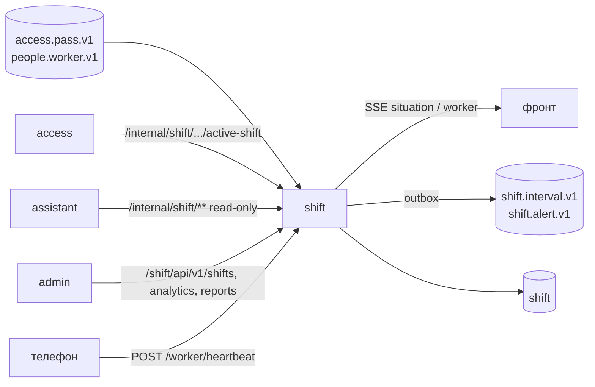

# ARCHITECTURE — shift

Система целиком — `../../../docs/ARCHITECTURE.md`, контракт — `../../../docs/API.md`, раскладка Java-сервиса — скилл `backend-spring`.

## Схема


## Поток
1. `PassDecided(ALLOW)` → `IntervalService` в транзакции: закрыть/открыть интервал, привязать к смене (окно пересекается с входом, включая ночь), `processed_events`, outbox `IntervalOpened/Closed`.
2. Планировщик раз в 5 мин: нет выхода к `shift_end + 2 ч` → `AUTO_SHIFT_END` + флаг; нет heartbeat 5 мин или вне геозоны → `AlertCreated`.
3. SSE-хаб: события из своих транзакций и `access.pass.v1` → подписчики по роли; `Last-Event-ID` + heartbeat-комментарий раз в 15 с.
4. Аналитика — jOOQ-запросы по интервалам и проекции попыток, без кэшей с выдуманными значениями.

## Стек
Spring Boot 3.5, jOOQ + Liquibase, Spring Kafka + outbox, `SseEmitter`, Apache POI (XLSX), `@Scheduled` + ShedLock не нужен (один инстанс).

## Структура папок
```
shift/
  AGENTS.md CLAUDE.md docs/
  src/main/java/.../shift/
    api/controller/       ShiftController, AnalyticsController, ReportController, StreamController, AlertController, WorkerController
    features/shift/       шаблоны, массовое назначение
    features/interval/    IntervalCalculator, IntervalService, AutoCloseJob
    features/analytics/   запросы summary/hours/late-overtime/refusals/load/occupancy
    features/report/      TimesheetXlsxWriter
    features/alert/       правила B-01, B-04, B-05
    features/stream/      SseHub, TicketService
    messaging/{consumer,outbox}  PassDecidedConsumer, WorkerConsumer
    internal/             ActiveShiftController
  src/test/java/.../      IntervalCalculatorTest (ночь, смена зоны, нет выхода), PassConsumerIdempotencyTest
```

## Данные
`shifts(worker_id, start, end, template_id)`, `shift_templates`, `presence_intervals(worker_id, zone_id, shift_id, entered_at, exited_at, close_reason, flags[])`, `pass_events` (проекция для аналитики отказов/нагрузки), `heartbeats`, `alerts(type, severity, ack_by)`, `stream_tickets`, `outbox`, `processed_events`.

## События
Публикует `shift.interval.v1`, `shift.alert.v1`. Слушает `access.pass.v1`, `people.worker.v1`.

## Зависимости
Нет синхронных зависимостей на пути данных (только Kafka). Keycloak — JWKS.

## Конфигурация (env, значения — `infra/.env.example`)
`AUTO_CLOSE_AFTER=2h`, `HEARTBEAT_TIMEOUT=5m`, `LATE_TOLERANCE=10m`, `DB_*`, `KAFKA_*`.
